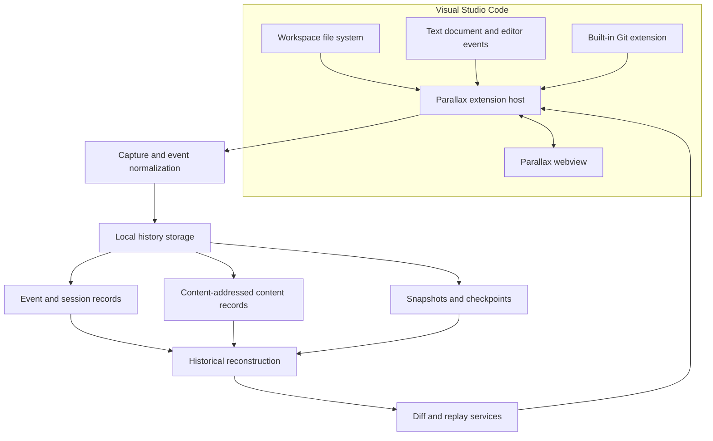
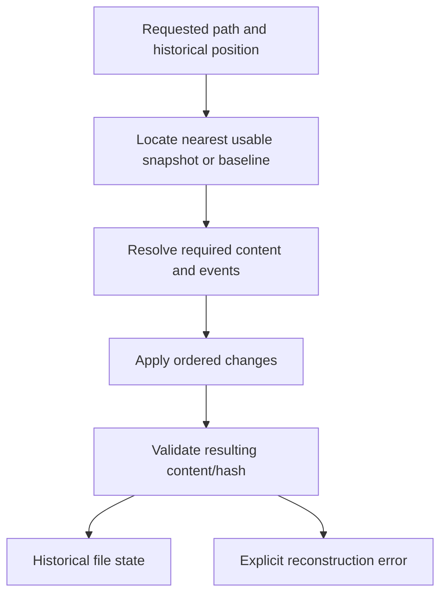

# Parallax Architecture

## Implementation status (2026-11)

The implementation includes multi-session browsing, indexed snapshot-assisted reconstruction with retention anchors, historical comparisons, bounded baseline inventory and guarded workspace restore, public Git API event capture, multi-root storage identity, writer leases, schema marker migration, and paginated timeline queries. A saved `.code-workspace` Extension Development Host integration test now exercises folder addition, removal, root switching, final-root removal, watcher behavior, identity-specific storage, and the read-only historical document provider. A changed set of workspace roots has a distinct workspace identity and therefore a distinct history store. The local filesystem restore still has a documented path-based TOCTOU limitation.

> This document describes the intended logical architecture based on the current product description. Confirm concrete class names, file paths, serializers, and storage layout against the source code before changing them. Where the implementation detail is not established by the repository documentation, it is explicitly described as a logical responsibility rather than a claim about a particular module.

## 1. Goals and non-goals

### Goals

- Capture meaningful supported development activity inside VS Code.
- Represent recorded activity as typed, identifiable, timestamped events.
- Fingerprint text-file contents with SHA-256.
- Persist history locally and survive VS Code restarts.
- Reconstruct historical file states and compare versions.
- Provide timeline, checkpoint, and replay experiences.
- Complement Git with finer-grained local history.
- Keep core functionality offline-capable and independent of hosted services.

### Non-goals for the current implementation

- Replacing Git or acting as a remote source-control host.
- Recording arbitrary binary files.
- Uploading history to a server or synchronizing devices.
- Requiring an AI model, API key, or account.
- Capturing terminal output, test runs, debugger sessions, or AI-agent prompts as current capabilities. These are possible future integrations, not part of the documented current event stream.
- Automatically executing historical commands or modifying a developer's workspace during replay.

## 2. System context

Parallax runs as a VS Code extension. Its principal runtime boundary is between the extension host and the webview UI.



### Main responsibilities

| Responsibility | Description |
|---|---|
| VS Code integration | Detect workspaces; subscribe to supported file, document, and Git activity; register commands, views, and configuration. |
| Capture and normalization | Convert external notifications into Parallax's typed event model; apply exclusions and debounce/coalescing rules. |
| Event/session history | Assign stable identities and timestamps, associate events with a workspace/session, and persist the history. |
| Content storage | Store text content by SHA-256 fingerprint and resolve content references during reconstruction. |
| Diff service | Generate and apply supported unified patches and calculate change statistics. |
| Snapshot/checkpoint service | Create periodic or user-requested recovery points. |
| Reconstruction/replay | Resolve historical file state and move through the event sequence. |
| Webview | Present timeline, file history, diffs, checkpoints, and replay controls. It should not own persistence or reconstruction logic. |

## 3. Workspace and session lifecycle

1. VS Code activates the extension for a supported workspace.
2. Parallax resolves a workspace identity using the implementation's established workspace rules. Do not assume a folder name alone is unique.
3. The recorder checks configuration and recording state.
4. A development session is created. Before queued file notifications are processed, Parallax captures a bounded baseline inventory of eligible UTF-8 text files and writes a fingerprinted snapshot. Incomplete scans are marked and cannot authorize full-workspace restoration.
5. Supported sources emit activity notifications.
6. Notifications pass through exclusion, normalization, and debounce/coalescing logic.
7. Accepted events are assigned stable identifiers and timestamps, then persisted.
8. Content references and diffs are stored as required by the event type.
9. Snapshot scheduling may create a reconstruction checkpoint.
10. On stop, workspace close, or extension shutdown, subscriptions are disposed and pending writes are handled according to the storage contract.

Session boundaries must be explicit and tested. VS Code restarts, workspace reopening, multi-root workspaces, and overlapping windows can expose lifecycle edge cases.

## 4. Logical event model

The following is a conceptual envelope to communicate the information an event system generally needs. It is **not a declaration of the current TypeScript interface**. Inspect the implementation before changing or copying its schema.

```typescript
interface LogicalParallaxEvent {
  eventId: string;          // stable identity
  schemaVersion: number;    // persisted-event compatibility
  workspaceId: string;
  sessionId: string;
  sequence: number;         // deterministic ordering within its defined scope
  occurredAt: number;       // event time, normally Unix milliseconds
  recordedAt: number;       // persistence/observation time if available
  type: string;             // typed event discriminator
  payload: unknown;         // type-specific, validated data
}
```

### Event design requirements

- **Identity:** event IDs must remain stable once persisted.
- **Ordering:** timestamps alone may not uniquely order events. Use the existing sequence or tie-breaking contract; do not introduce ambiguous ordering.
- **Time semantics:** distinguish when activity occurred from when it was observed or persisted if delayed notifications matter.
- **Schema evolution:** persisted event schemas need a versioning and compatibility strategy.
- **Payload minimization:** store content references and essential metadata rather than duplicating large source contents in every event.
- **Truthfulness:** an event should describe what Parallax observed. Inferred intent or causal explanations must be represented separately and labeled as inference.

### Current documented event families

- File creation
- File modification
- File deletion
- File rename
- File save
- Basic Git activity, including supported commit and checkout events
- Session and checkpoint records as supported by the current implementation

Terminal, test, debugger, diagnostic, and AI-agent event families are future work unless verified in source.

## 5. Capture pipeline

The capture pipeline should be treated as a boundary between noisy VS Code/workspace notifications and durable history.

```mermaid
flowchart LR
    SRC[VS Code and Git notifications] --> FILTER[Workspace and exclusion filter]
    FILTER --> NORM[Normalize event]
    NORM --> DEBOUNCE[Debounce / coalesce]
    DEBOUNCE --> CONTENT[Read and hash content when applicable]
    CONTENT --> EVENT[Build typed event and diff]
    EVENT --> PERSIST[Persist event and content references]
    PERSIST --> INDEX[Update reconstruction/index state]
```



Important concerns:

- File watchers can emit duplicate or reordered notifications.
- A save, document change, rename, and file-system event may refer to overlapping activity.
- A file can disappear between notification and read.
- A workspace can close while asynchronous work is pending.
- Excluded files must not leak through an alternate capture path.
- Large files should not block the extension host or cause unbounded memory use.

The current configured debounce setting is documented as `parallax.debounceMs`. Preserve its observable semantics unless a specification defines a change.

## 6. Content-addressed storage

Parallax uses SHA-256 content hashing to identify text-file contents.

Logical model:

```text
File version reference
       |
       +---- SHA-256(content bytes)
                    |
                    v
             Content record
             - hash
             - encoded text content
             - optional storage metadata
```

### Invariants

1. The same content, under the same byte-encoding rules, should resolve to the same hash.
2. A hash identifies content, not a path. A path can point to different content over time; multiple paths may share identical content.
3. Content references must resolve to the expected content or produce an integrity/reconstruction error.
4. Content should be deduplicated where the implementation supports it.
5. File path, file version, and content identity must remain distinct concepts.
6. Excluded files must not be stored merely because another feature requests a snapshot.

Do not silently change encoding, line-ending, or normalization rules. Such a change can invalidate historical fingerprints and requires a migration strategy.

## 7. Diffs, snapshots, and checkpoints

### Diffs

The diff service represents changes between file versions using unified patches and added/removed line statistics. A patch is a derived representation; the content records and event history remain the reliable basis for reconstruction.

The implementation must handle:

- Empty files and empty diffs.
- File creation and deletion.
- Renames, including path changes without content changes.
- Line-ending and encoding edge cases within the supported text-file contract.
- Missing base content or malformed patches.

### Snapshots

Periodic and on-demand snapshots provide recovery/reconstruction anchors. The documented default interval is 30 minutes, configurable with `parallax.snapshotIntervalMinutes`.

Snapshots are fingerprinted path-to-content-reference manifests. A baseline snapshot can identify whether initial eligible-text inventory completed and carries a bounded list of unsupported or symlinked paths (excluded paths are not listed). The sparse JSONL offset index is regenerable and is not authoritative. Reconstruction validates snapshot fingerprints and blob hashes, seeks from the nearest valid snapshot, and reads only subsequent events. Corrupt accelerators fall back to an earlier snapshot or event replay. Range reads are capped at 100,000 events and 64 MiB; larger ranges fail clearly instead of allocating the full history.

### Named checkpoints

Named checkpoints let developers label meaningful points. A checkpoint should unambiguously refer to the state it represents. If the implementation does not currently capture a complete workspace manifest for a checkpoint, do not claim that it can restore the entire workspace.

## 8. Historical reconstruction

At a high level, reconstruction resolves a requested point in the event history and computes the state of a file at that point.



### Required properties

- Deterministic output for the same valid history and target position.
- Clear ordering semantics for events sharing a timestamp.
- Explicit handling of missing content, corrupt records, and unsupported file states.
- No writes to the active workspace during inspection or replay.
- Reproducible tests for create/modify/delete/rename sequences.

The documented current capability is historical **file-state** reconstruction. Do not describe it as exact whole-workspace reconstruction until a complete workspace manifest and all relevant file states are captured and validated.

## 9. Replay engine

Replay navigates the recorded event sequence and exposes historical state through controls such as step backward, step forward, play, and scrub.

A replay position must map to a well-defined event order and historical state. The webview should request state from the extension-side history/reconstruction services rather than attempting to recreate durable storage semantics in browser code.

Replay is observational. It must not execute commands, mutate the actual project, or change Git branches.

## 10. VS Code integration

The extension integrates with VS Code for:

- Workspace detection and lifecycle.
- Supported file/document activity observation.
- Built-in Git extension awareness.
- Commands: start recording, stop recording, open timeline, create checkpoint.
- Activity Bar/sidebar presentation.
- Webview communication.
- Extension-managed local storage and configuration.

The README documents the minimum VS Code engine as 1.85 or later. Validate APIs against the project's actual `engines.vscode` and TypeScript types before relying on newer functionality.

### Webview contract

Treat all messages as untrusted. Validate message type, required fields, identifier shape, and allowed operations on the extension host. Do not accept arbitrary file-system paths or arbitrary commands from the webview.

The compiled React webview uses a shared CSS token layer backed by VS Code theme variables, a paginated chronological event list, session/checkpoint navigation, replay controls, event details, and line-aligned historical comparisons. Historical contents open through a `parallax-history` text-document provider; the custom URI is read-only and uses the file suffix for VS Code language services. The webview's inline code panel remains a read-only monospace preview. Its layout collapses to stacked panes in narrow widths, honors reduced motion, and includes high-contrast borders/focus indicators. Browser-DOM tests exercise the production bundle and message actions. Session-scoped request validation and response guards reject stale pages/content/comparisons after a session switch; checkpoint responses also carry a per-selection token. Workspace reconfiguration refreshes the open provider after initialization. Theme/width appearance has not been manually screenshot-reviewed in this environment.

## 11. Persistence and recovery

The documented history location is VS Code-managed local extension storage. The precise subdirectory and serialization layout must be verified in source.

Storage changes must consider:

- Atomicity of writes where practical.
- Partial writes and process termination.
- Corrupt or missing records.
- Storage growth and retention.
- Version upgrades and backward compatibility.
- Workspace identity collisions and moved folders.
- Multiple VS Code windows accessing related workspaces.

Do not promise database-grade transactions unless the implementation provides them.

## 12. Planned architecture: verification and Causal Rewind

This section describes a proposed extension to the current architecture. It is not implemented functionality.

### Verification records

A future verification record should associate a test command/result with a well-defined workspace manifest or fingerprint. It should capture enough metadata to determine whether the workspace changed during the test. It should not claim that a passing result validates a different workspace state.

A logical record may include:

- Verification ID and timestamp.
- User-approved command or VS Code test identifier.
- Exit status and duration.
- Workspace manifest/fingerprint before and after execution.
- Runtime/tool versions where available.
- Output references only when explicitly enabled and safely redacted.
- Reproducibility status and limitations.

### Causal Rewind

Causal Rewind is a proposed experiment workflow:

1. Select a known-good and a reproducibly failing state.
2. Confirm that the relevant baseline and failure can be reconstructed.
3. Extract candidate recorded changes between the states.
4. Create an isolated experiment workspace.
5. Apply subsets of candidate changes and run an explicitly approved verification command.
6. Minimize the changes while preserving the failure.
7. Report the minimal failure-inducing set found, all experiment outcomes, and limitations.

This is not proof of a unique root cause. Delta debugging and regression bisection are established techniques. Parallax's proposed contribution is applying controlled minimization to its own fine-grained, local development history, including uncommitted changes.

### Safety requirements for experiments

- Never run experiments in the user's active workspace.
- Never replay arbitrary recorded terminal commands automatically.
- Require explicit approval of the test command and any environment setup.
- Use a disposable, isolated workspace with explicit boundaries.
- Do not copy secrets by default. Make environment dependencies explicit.
- Detect workspace mutation during test execution.
- Detect or flag flaky/non-deterministic tests.
- Bound runtime, disk use, number of experiments, and concurrency.
- Stop safely on cancellation, process failure, or storage exhaustion.
- Preserve a complete experiment log and the original workspace state.

## 13. Observability and error handling

The extension should make operational failures understandable without leaking sensitive content. Prefer structured diagnostic metadata such as operation, event ID, workspace ID, elapsed time, and error category. Avoid logging file contents, tokens, environment values, or raw terminal output.

Failures should be explicit: missed event, storage error, missing content, reconstruction failure, unsupported file, Git provider unavailable, and cancelled operation should not collapse into a generic success state.

## 14. Architecture decision records

For consequential changes, add an ADR under `docs/architecture/decisions/` using this structure:

- Context and problem.
- Decision.
- Alternatives considered.
- Consequences and trade-offs.
- Security/privacy implications.
- Data migration and compatibility implications.
- Status and date.

## 15. Open questions to verify against source

Before making architecture-level changes, confirm:

- The actual persisted event schema and ordering guarantee.
- Whether content blobs are stored separately from events and whether deduplication is global or workspace-scoped.
- How snapshots represent workspace/file state.
- Whether checkpoints represent one file or the entire workspace.
- How workspace identity is generated and how multi-root workspaces are handled.
- How rename detection works and what happens for ambiguous file-system events.
- How writes are made durable during shutdown.
- What test coverage exists for corrupted/missing history and concurrent VS Code windows.
